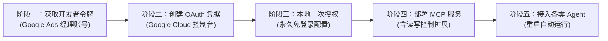

# Google Ads AI Agent (MCP) 接入全流程交付手册（SOP）

本手册将指导您从零开始，将您的 **Google Ads 真实广告账户** 接入本地 AI Agent（支持 Claude Desktop、Cursor、Antigravity、Windsurf、Cline、LangChain / 自定义 Agent 等所有支持 MCP 协议的客户端），实现通过自然语言查询报表、诊断账户、创建广告系列、管理关键词与调整预算。



> [!TIP]
> **服务商极速交付提示（致管理员）**：
> 为客户电脑部署时，有两种交付模式可选：
> * **独立自建模式（完整走阶段一至阶段五，约 15 分钟）**：客户使用自己的 Google 邮箱申请全部凭证，完全独立。
> * **极速交付模式（跳过阶段一和阶段二，仅需 3 分钟）**：把客户的 Google 邮箱加进您 Google Cloud 项目的「测试用户」白名单（或将应用设为 `In production`），直接把您的 `client_secret.json` 和 `Developer Token` 拷到客户电脑上，客户只需执行阶段三登录自己的 Google Ads 账号，即可直接管理自己的广告账户（您看不到客户数据，凭证保存在客户本地电脑）。

---

## 阶段一：获取 Google Ads API 开发者令牌（Developer Token）

> [!IMPORTANT]
> **核心避坑 1**：普通个人广告账户后台的「管理 (Admin)」菜单里**没有「API 中心」**。必须用同一个 Google 邮箱免费开通一个 **经理账号（MCC）** 来领取 22 位的开发者令牌；**原有的广告推广仍然 100% 在老账号中进行，无需换号或重新绑卡**。

1. **免费开通 Google Ads 经理账号（MCC）**
   * 打开官方经理账号注册页：[https://ads.google.com/home/tools/manager-accounts/](https://ads.google.com/home/tools/manager-accounts/)
   * 点击 **「创建经理账号 (Create a manager account)」**，使用您平时管理 Google Ads 的同一个 Google 邮箱登录。
   * **账号显示名称**：自定义（如 `我的广告管理中心`）。
   * **账号主要用途**：选择 **「管理我的账号 (To manage my accounts)」**，设置国家、时区、币种后点击提交。
2. **复制 22 位开发者令牌（Developer Token）**
   * 进入新建好的**经理账号**后台，点击左侧菜单最底部的 **「管理 (Admin)」 -> 「API 中心 (API Center)」**。
   * 首次进入填写联系邮箱与公司名称并保存。
   * 在页面顶部找到 **「开发者令牌 (Developer token)」**，复制这串 **22 位的字符串**（例如：`Ygfe1mGSzOOnxG6WRhZERw`）备用。
   * 确认下方的 **「访问权限级别 (Access level)」** 为 **「探索者权限 (Explorer Access)」** 或更高（探索者权限自带每天 2,880 次真实账号操作额度，可直接读写生产账号）。
3. **记录您的实际推广账号 ID**
   * 记录您平时绑卡投广告的 **10 位客户账号 ID**（位于网页右上角，如 `620-450-6866`，使用时去掉横杠为 `6204506866`）。

---

## 阶段二：在 Google Cloud 创建 OAuth 桌面客户端凭据

> [!WARNING]
> **核心避坑 2（解决「系统已封锁此应用程序」与「7 天授权过期」）**：
> Google Ads 权限属于高敏感权限，未添加测试用户会被拦截封锁；而如果保持在 `Testing` 状态，授权每 7 天就会过期一次。请严格按以下 4 步设置，实现**不封锁 + 永久免重新授权**。

1. **创建 Google Cloud 项目并启用 Google Ads API**
   * 打开 [Google Cloud Console](https://console.cloud.google.com/)，在顶部新建一个项目（或选择现有项目）。
   * 访问 [Google Ads API 启用页面](https://console.cloud.google.com/apis/library/googleads.googleapis.com)，点击蓝色的 **「启用 (ENABLE)」** 按钮。
2. **配置 OAuth 同意画面（解决封锁与 7 天过期）**
   * 打开 [OAuth 同意画面 / Google Auth Platform](https://console.cloud.google.com/apis/credentials/consent)。
   * **User Type（用户类型）**：普通 Gmail 选 **External（外部）**；企业 Workspace 邮箱可选 **Internal（内部）**。
   * 填写应用名称（如 `Ads Local Agent`）和您自己的邮箱，一路保存。
   * 在 **Audience（受众 / 测试用户）** 页面：
     * 先在 **Test users（测试用户）** 下点击 **+ ADD USERS**，填入您自己的 Google 邮箱。
     * 紧接着在 **Publishing status（发布状态）** 下点击 **「PUBLISH APP（发布应用）」** 将状态切换为 **`In production（生产环境）`**。
     * *(注：切换为生产环境后，提示“需要提交审核验证”时**直接忽略、不要提交材料**！仅自己使用无需审核，且切换后 Refresh Token 将变为**永久有效**，不会每 7 天失效)*。
3. **创建「桌面应用」类型的 OAuth 客户端 ID**
   * 打开 [凭据页面 (Credentials)](https://console.cloud.google.com/apis/credentials)。
   * 点击顶部 **「+ 创建凭据 (+ CREATE CREDENTIALS)」 -> 「OAuth 客户端 ID (OAuth client ID)」**。
   * **应用类型 (Application type)**：**必须选择「桌面应用 (Desktop app)」**（切勿选 Web 应用）。
   * 点击创建后，在弹窗中点击 **「下载 JSON (Download JSON)」**，将下载的文件重命名为 `client_secret.json`，保存到固定目录（例如 `C:\scripts\google-ads-auth\client_secret.json`）。

---

## 阶段三：在电脑本地完成一次性永久授权

1. **安装 Google Cloud CLI (`gcloud`) 与 Python (>= 3.10)**
   * 若电脑尚未安装 `gcloud`，下载并安装 [Google Cloud SDK 安装包](https://cloud.google.com/sdk/docs/install)。
   * 确保已安装 Python 3.10 或更高版本，以及 Git。
2. **使用自定义凭据执行本地 OAuth 授权**
   * 打开 **PowerShell**（Windows）或 **Terminal**（macOS），运行以下命令（请确保 `--client-id-file` 指向您刚刚下载的 `client_secret.json`）：

```powershell
gcloud auth application-default login `
  --client-id-file="C:\scripts\google-ads-auth\client_secret.json" `
  --scopes="https://www.googleapis.com/auth/adwords,https://www.googleapis.com/auth/cloud-platform"
```

3. **在弹出的浏览器中放行权限**
   * 登录您的 Google Ads 邮箱。
   * 出现 **「Google 尚未验证此应用 (Google hasn't verified this app)」** 提示时：
     1. 点击左下角的 **「高级 (Advanced)」**。
     2. 点击最下方的 **「前往 xxx（不安全） / Go to xxx (unsafe)」**。
     3. 勾选全部权限并点击 **「继续 (Continue)」**。
   * 看到浏览器提示授权成功后，凭证已永久保存在本地硬盘（Windows 路径为 `%APPDATA%\gcloud\application_default_credentials.json`），**今后重启电脑也无需再次登录**。

---

## 阶段四：部署 Google Ads MCP 服务（含读写控制能力）

Google 官方原版仓库默认仅提供只读查询（`search` 和 `list_accessible_customers`）。为了支持通过 Agent **创建广告系列、启停广告、管理关键词**，按以下步骤部署并开启 `mutate` 扩展模块：

### 1. 克隆仓库并安装虚拟环境

在 PowerShell 中依次执行：

```powershell
# 1. 创建目录并克隆官方仓库
New-Item -ItemType Directory -Force -Path "C:\scripts"
git clone https://github.com/googleads/google-ads-mcp.git C:\scripts\google-ads-mcp
cd C:\scripts\google-ads-mcp

# 2. 创建虚拟环境并安装依赖
python -m venv .venv
.\.venv\Scripts\python.exe -m pip install -U pip
.\.venv\Scripts\pip.exe install -e .
```

### 2. 开启广告写入与控制模块（`mutate.py`）

> [!NOTE]
> 如果是在客户电脑上部署，您可以直接将您电脑上已经配置好的 `C:\scripts\google-ads-mcp` 文件夹打包拷给客户（然后运行一次 `.\.venv\Scripts\pip.exe install -e .`），或者复制以下 3 个文件修改：

1. **在 `C:\scripts\google-ads-mcp\ads_mcp\config.py` 中启用 `mutate` 分类**：
   将 `ALL_CATEGORIES = ["customers", "search", "metadata"]` 修改为：
   ```python
   ALL_CATEGORIES = ["customers", "search", "metadata", "mutate"]
   ```
2. **在 `C:\scripts\google-ads-mcp\ads_mcp\tools_config.yaml` 中加入 `mutate: true`**：
   ```yaml
   namespaces:
     customers: true
     search: true
     metadata: true
     mutate: true
   ```
3. **新增 [`C:\scripts\google-ads-mcp\ads_mcp\tools\mutate.py`](file:///C:/scripts/google-ads-mcp/ads_mcp/tools/mutate.py)**（内置创建暂停状态的广告系列、修改广告系列状态等安全工具）。

---

## 阶段五：接入各类 AI Agent（配置一次，开机自启）

MCP 采用 `stdio` 按需唤醒机制：**您不需要手动开命令行黑窗口运行 MCP**。只需将以下 JSON 配置写入您使用的 Agent 客户端配置文件中，每次打开 Agent 软件时，它会自动在后台拉起 Google Ads MCP 服务。

### 通用标准 MCP 配置片段

无论是 **Antigravity**、**Claude Desktop**、**Cursor**、**Windsurf** 还是 **Cherry Studio / Cline**，均使用以下相同的 `google-ads` 配置项（只需将 `GOOGLE_ADS_DEVELOPER_TOKEN` 替换为阶段一获取的 22 位令牌）：

```json
{
  "mcpServers": {
    "google-ads": {
      "command": "C:\\scripts\\google-ads-mcp\\.venv\\Scripts\\google-ads-mcp.exe",
      "args": [],
      "env": {
        "GOOGLE_ADS_DEVELOPER_TOKEN": "填入您的22位Developer_Token",
        "PYTHONUTF8": "1"
      }
    }
  }
}
```

### 各主流 Agent 的配置文件位置对照表

| Agent 客户端名称 | 配置文件路径（Windows） | 接入方式说明 |
| :--- | :--- | :--- |
| **Antigravity** | `C:\Users\<用户名>\.gemini\config\mcp_config.json` | 将 `"google-ads"` 块添加到 `"mcpServers"` 字典下并保存 |
| **Claude Desktop** | `%APPDATA%\Claude\claude_desktop_config.json` | 在 `Settings -> Developer -> Edit Config` 中粘贴并重启 Claude |
| **Cursor** | `C:\Users\<用户名>\.cursor\mcp.json` | 或在 `Cursor Settings -> MCP -> Add new global MCP server` 中添加 |
| **Windsurf** | `C:\Users\<用户名>\.codeium\windsurf\mcp_config.json` | 在 MCP 面板点击 `Configure` 粘贴保存并点击 `Refresh` |
| **Cline (VS Code)** | VS Code 侧边栏 Cline -> `MCP Servers` -> `Configure MCP Servers` | 在打开的 `cline_mcp_settings.json` 中粘贴保存 |
| **自研 Python Agent** | 通过 `mcp.client.stdio` 传入 `StdioServerParameters` | `command="C:/scripts/google-ads-mcp/.venv/Scripts/google-ads-mcp.exe"` |

---

## 阶段六：验收测试与日常使用指令模板

接入完成后，打开任意已配置好的 Agent，发送以下三句提示词进行最终验收：

1. **验收 1：测试账号连通性**
   > 🗣️ *“调用 Google Ads 工具，列出我当前可以访问的所有 Google Ads 账号 ID。”*
   * **预期结果**：返回您的 10 位推广账号 ID 和经理账号 ID。
2. **验收 2：测试报表数据查询**
   > 🗣️ *“查询我广告账号 `620-450-6866` 下所有的广告系列名称、ID、类型和当前状态。”*
   * **预期结果**：准确列出当前账号中的所有广告系列。
3. **验收 3：测试安全创建广告系列（只创建不开启）**
   > 🗣️ *“在我的广告账号 `620-450-6866` 中创建一个名为 `AI测试搜索系列`、日预算为 10 的搜索广告系列，注意保持暂停（PAUSED）状态不要开启。”*
   * **预期结果**：返回创建成功的 `campaign_resource_name`，刷新 Google Ads 网页后台即可在「所有广告系列」中看到处于「已暂停」状态的新广告系列。
