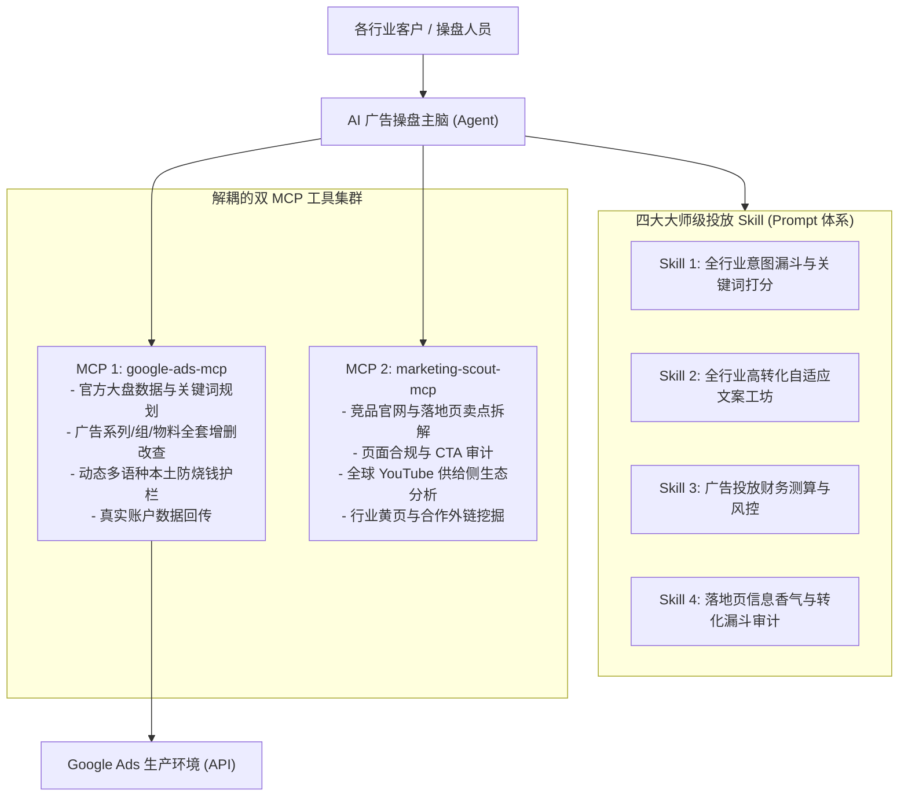

# 通用专家级 AI 广告营销系统商业交付手册

本手册基于生产级工程验证编写，记录了如何将**Google Ads 执行主节点**、**独立市场竞品情报节点**以及**四大通用领域投放 Skill**组合交付给任意行业的企业客户（全面覆盖 B2B 工业/制造/贸易/服务与 B2C 各类出海零售）。



---

## 一、双 MCP 集群职责与部署位置

为了保障核心广告账户的安全，我们将**内部投放控制**与**外部公开互联网情报**进行物理级解耦：

| MCP 服务名称 | 本地路径 | 核心定位与职责 |
| :--- | :--- | :--- |
| **`google-ads`** | `C:\scripts\google-ads-mcp` | **执行主节点**：直连 Google Ads 官方 API，负责广告系列、广告组、关键词、Sitelinks 附加链接、Callouts 宣传标签的创建，以及动态多语言否定词注入与真实报表审计。 |
| **`marketing-scout`** | `C:\scripts\marketing-scout-mcp` | **外部市场与竞品情报节点**：无需账户凭据，纯外部抓取竞品落地页、解析竞品 H1/H2 卖点与 CTA，分析 YouTube 视频供给侧竞争度及挖掘行业合作站点。 |

---

## 二、四大通用领域投放 Skill（领域专家知识资产）

四大通用 Skill 已完整落盘至本地：[`C:\scripts\google-ads-skills\`](file:///C:/scripts/google-ads-skills/)

1. **[`01_全行业意图漏斗与关键词价值评估.md`](file:///C:/scripts/google-ads-skills/01_全行业意图漏斗与关键词价值评估.md)**：
   * 建立四层意图漏斗（Tier 1 交易收割词、Tier 2 竞品词、Tier 3 评估词、Tier 4 信息泛词）；
   * 自动过滤只求知不购买的低效泛词，计算 `0~100` 的关键词商业可行性打分。
2. **[`02_全行业高转化自适应广告文案与物料工坊.md`](file:///C:/scripts/google-ads-skills/02_全行业高转化自适应广告文案与物料工坊.md)**：
   * 严格遵守 Google 标题 ≤ 30 字符、描述 ≤ 90 字符规范；
   * 按照“相关性词 (1/3) + USP痛点价值 (1/3) + 行动号召CTA (1/3)”的黄金文案矩阵构建；
   * 自动配齐 Sitelinks（附加链接）与 Callouts（宣传标签）全套物料。
3. **[`03_广告投放财务测算与全生命周期风控.md`](file:///C:/scripts/google-ads-skills/03_广告投放财务测算与全生命周期风控.md)**：
   * 根据客单价与毛利率，逆向推导保本 Target CPA 上限；
   * 测算进入 Google 机器学习算法的最低测试预算；
   * 划定冷启动期（第1-7天）、校准期（第8-21天）与放量期（第22天后）的科学放量节奏。
4. **[`04_落地页信息香气与转化漏斗审计.md`](file:///C:/scripts/google-ads-skills/04_落地页信息香气与转化漏斗审计.md)**：
   * 自动核对广告词是否在落地页首屏 H1 中出现（信息香气审查）；
   * 检查网站是否包含 Privacy Policy 等 Google 广告政策硬性合规页面。

---

## 三、各客户端双 MCP 协同配置（可直接交付）

### 1. DeepSeek 客户端配置 (`yaml`)
将以下内容直接粘贴至 DeepSeek 的 MCP 配置文件中：

```yaml
- id: mcp-google-ads
  name: "@deepseek-ai/dsh-mcp-client"
  config:
    serverName: google-ads
    transport: stdio
    command: "C:/scripts/google-ads-mcp/.venv/Scripts/python.exe"
    args: ["-m", "ads_mcp.server"]
    cwd: "C:/scripts/google-ads-mcp"
    env:
      GOOGLE_ADS_DEVELOPER_TOKEN: "填入客户的22位Developer_Token"
      PYTHONUTF8: "1"
    failOnStartupError: false
    toolCallTimeoutMs: 180000

- id: mcp-marketing-scout
  name: "@deepseek-ai/dsh-mcp-client"
  config:
    serverName: marketing-scout
    transport: stdio
    command: "C:/scripts/google-ads-mcp/.venv/Scripts/python.exe"
    args: ["C:/scripts/marketing-scout-mcp/scout_server.py"]
    cwd: "C:/scripts/marketing-scout-mcp"
    env:
      PYTHONUTF8: "1"
    failOnStartupError: false
    toolCallTimeoutMs: 60000
```

### 2. Antigravity / Cursor / Claude Desktop 配置 (`json`)
```json
{
  "mcpServers": {
    "google-ads": {
      "command": "C:\\scripts\\google-ads-mcp\\.venv\\Scripts\\python.exe",
      "args": ["-m", "ads_mcp.server"],
      "env": {
        "GOOGLE_ADS_DEVELOPER_TOKEN": "填入客户的22位Developer_Token",
        "PYTHONUTF8": "1"
      }
    },
    "marketing-scout": {
      "command": "C:\\scripts\\google-ads-mcp\\.venv\\Scripts\\python.exe",
      "args": ["C:\\scripts\\marketing-scout-mcp\\scout_server.py"],
      "env": {
        "PYTHONUTF8": "1"
      }
    }
  }
}
```

---

## 四、全流程操盘实战指令范例

部署完成后，任何行业的客户都可以通过自然语言驱动这套专家级系统：

1. **第一步：竞品与落地页深度调研**
   > 🗣️ *“请使用 marketing-scout 工具分析竞品落地页 `https://competitor.com/product`，提炼他们的核心主标题、卖点和行动号召，同时诊断我们自己的落地页 `https://ourdomain.com` 是否具备合规隐私政策。”*
2. **第二步：多国意图漏斗拓词与打分**
   > 🗣️ *“我们是一家从事工业自动化配件制造的外贸企业（B2B），客单价约 $3000。请调研北美市场，运用意图漏斗模型选出 5 个高意图收割词，并测算进入学习期建议的每日预算。”*
3. **第三步：动态多语种防护与物料生成**
   > 🗣️ *“为选出的核心词打造一组专业的自适应搜索广告，配齐 2 个附加链接和 3 个宣传标签，并动态注入北美市场的求职与免费类防烧钱否定词，输出审批卡片给我确认。”*
