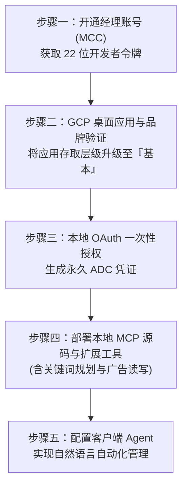

# Google Ads AI Agent (MCP) 商业级客户全流程交付手册

本指南基于真实工程验证编写，记录了从**零注册账号**到**打通官方关键词规划师与广告读写管理**的完整标准作业程序（SOP）。本手册专为交付客户或团队运维设计，重点收录了**品牌验证盲区**、**存取层级升级**及**本地工具扩展**等关键实战经验。



---

## 步骤一：开通 Google Ads 经理账号（MCC）并获取开发者令牌

> [!IMPORTANT]
> **交付注意点**：普通个人广告账号后台没有「API 中心」菜单。必须使用同一个 Google 邮箱免费开通一个 **Google Ads 经理账号（MCC）** 作为外壳来申领开发者令牌；**客户原有的推广计划、绑卡信息和投放账户无需更换，直接由该经理账号统一管理。**

1. **注册经理账号 (MCC)**：
   * 访问官方注册地址：[https://ads.google.com/home/tools/manager-accounts/](https://ads.google.com/home/tools/manager-accounts/)。
   * 点击 **「创建经理账号 (Create a manager account)」**，登录客户的 Google 邮箱。
   * **账号用途**：选择 **「管理我的账号 (To manage my accounts)」**。
   * 填写账号名称、国家时区与结算币种后点击提交。
2. **复制开发者令牌 (Developer Token)**：
   * 进入经理账号后台（确认右上角显示为经理账号的 10 位 ID，如 `510-067-2942`）。
   * 点击左侧最底部的 **「管理 (Admin)」 -> 「API 中心 (API Center)」**。
   * 页面顶部显示一串 **22 位的字符串**（如 `Ygfe1mGSzOOnxG6WRhZERw`），复制保存为 `GOOGLE_ADS_DEVELOPER_TOKEN`。
3. **记录实际投放账号 ID**：
   * 记录用于投放付费的子账号 10 位数字（如 `620-450-6866`，去掉中划线为 `6204506866`）。

---

## 步骤二：Google Cloud 桌面应用创建与品牌验证（核心避坑）

> [!CAUTION]
> **核心认知纠正（关键避坑）**：
> 官方关键词规划师（`KeywordPlanIdeaService`）需要基础访问层级（Basic Access）。**权限的升级并非在 Ads 经理账号后台申请，而是在 Google Cloud 控制台完成品牌验证与应用发布后直接提升！**

### 1. 启用 API 与创建桌面应用凭据
1. 登录 [Google Cloud Console](https://console.cloud.google.com/)，创建或选择项目。
2. 在 **API 和服务 -> 启用 API 和服务** 中搜索并启用 **Google Ads API**。
3. 进入 **凭据 (Credentials) -> 创建凭据 -> OAuth 客户端 ID**：
   * **应用类型 (Application Type)**：**必须选择「桌面应用 (Desktop app)」**。
   * 创建后点击 **下载 JSON (Download JSON)**，保存为 `client_secret.json`。

### 2. 品牌验证（Brand Verification）全流程与盲区提示
1. 访问品牌页面：[https://console.cloud.google.com/auth/branding](https://console.cloud.google.com/auth/branding)。
2. **填写品牌核心信息（必须符合规范）**：
   * **应用名称 (App Name)**：填写自有品牌或工具名称（如 `YourBrand Ads Agent`）。
   * **用户支持电子邮件**：选择当前管理员邮箱。
   * **应用徽标 (Logo)**：上传一张 120x120px、格式合规的品牌图片。
   * **应用网域信息（必须为能正常访问的真实外链）**：
     * **应用首页 (Home page)**：如 `https://yourdomain.com`。
     * **应用隐私权政策链接 (Privacy policy)**：必须能公开打开，如 `https://yourdomain.com/privacy`。
     * **应用服务条款链接 (Terms of service)**：必须能公开打开，如 `https://yourdomain.com/terms`。
   * **已获授权的网域 (Authorized domains)**：添加一级域名（如 `yourdomain.com`）。
   * **开发者联系信息**：填写日常接收通知的邮箱。
3. **点击保存，并执行关键一步：右侧验证按钮**：
   > [!WARNING]
   > **易漏盲区**：资料填写完成并保存后，系统不会自动触发审核。请注意查看 **页面右上角（或右侧信息卡片面板）**，找到并点击蓝色的 **「验证品牌 (Verify)」** 按钮！很多人保存后直接离开，导致应用一直卡在未验证状态。

### 3. 发布应用与提升存取层级至『基本』
1. 品牌信息保存并提交验证后，进入 **OAuth 同意屏幕 / 受众群体 (Audience)** 页面。
2. 将 **发布状态 (Publishing status)** 从 `Testing（测试中）` 点击 **「发布应用 (Publish App)」** 切换为 **`正式版 / In production（已发布）`**。
3. 检查存取层级：应用完成发布并配合品牌信息后，存取层级成功从 **探索者 (Explorer)** 提升至 **基本 (Basic)**。
   * 这直接解除了 Google Ads 官方关键词规划师的接口限制！

---

## 步骤三：本地 OAuth 一次性授权（永久免登录）

1. **环境准备**：
   * 确保客户电脑已安装 Python 3.10+、Git 以及 [Google Cloud CLI (gcloud)](https://cloud.google.com/sdk/docs/install)。
2. **执行本地授权**：
   * 打开命令行，指定在步骤二下载的 `client_secret.json` 路径执行命令：
     ```powershell
     gcloud auth application-default login `
       --client-id-file="C:\scripts\google-ads-auth\client_secret.json" `
       --scopes="https://www.googleapis.com/auth/adwords,https://www.googleapis.com/auth/cloud-platform"
     ```
3. **浏览器放行授权**：
   * 浏览器弹窗中登录 Google 账号。
   * 如果出现安全提示，点击 **「高级 (Advanced)」 -> 「前往（不安全）」** 并勾选全部权限继续。
   * 授权完成后，凭据将保存在本地系统目录（`%APPDATA%\gcloud\application_default_credentials.json`），今后电脑重启、MCP 重启均无需再次登录。

---

## 步骤四：部署本地 MCP 源码与完整扩展函数库

Google 官方原版开源项目仅支持只读 GAQL 查询。我们在交付包中集成了**关键词规划**与**广告写入控制**模块。

### 1. 源码部署与依赖安装
```powershell
# 1. 建立目录并克隆
New-Item -ItemType Directory -Force -Path "C:\scripts"
git clone https://github.com/googleads/google-ads-mcp.git C:\scripts\google-ads-mcp
cd C:\scripts\google-ads-mcp

# 2. 建立虚拟环境并安装依赖
python -m venv .venv
.\.venv\Scripts\python.exe -m pip install -U pip
.\.venv\Scripts\pip.exe install -e .
```

### 2. 配置与工具函数注册
1. **修改 `ads_mcp\config.py`**：
   ```python
   # 将支持的类别扩展为：
   ALL_CATEGORIES = ["customers", "search", "metadata", "mutate", "keywords"]
   ```
2. **修改 `ads_mcp\tools_config.yaml`**：
   ```yaml
   namespaces:
     customers: true
     search: true
     metadata: true
     mutate: true
     keywords: true
   ```
3. **写入关键词规划与广告管理工具集**：
   在 `ads_mcp\tools\` 目录下提供两个核心扩展模块：
   * [`mutate.py`](file:///C:/scripts/google-ads-mcp/ads_mcp/tools/mutate.py)：包含 `create_paused_search_campaign`（安全创建已暂停的广告系列）、`update_campaign_status`（启停系列）、`update_campaign_budget`（调预算）、`create_ad_group`（建广告组）。
   * [`keywords.py`](file:///C:/scripts/google-ads-mcp/ads_mcp/tools/keywords.py)：包含官方 `generate_keyword_ideas`（调用官方大盘查询月搜索量、竞争度、高低页首出价）、`list_account_keywords`（查词质量分与状态）、`get_search_terms_report`（拉取真实搜索词）、`add_keywords_batch`（批量添加正/否定词）、`update_keyword`（调整词出价）。

---

## 步骤五：接入各类 AI Agent 客户端

MCP 基于 `stdio` 通信，不需要手动维持后台命令窗口。Agent 启动时会自动调起服务。

### 1. 标准 MCP 配置 JSON
在客户端配置中填入以下内容（替换为客户的实际路径与 22 位 Token）：

```json
{
  "mcpServers": {
    "google-ads": {
      "command": "C:\\scripts\\google-ads-mcp\\.venv\\Scripts\\google-ads-mcp.exe",
      "args": [],
      "env": {
        "GOOGLE_ADS_DEVELOPER_TOKEN": "在此填入22位开发者令牌",
        "PYTHONUTF8": "1"
      }
    }
  }
}
```

### 2. 常见客户端配置入口

| 客户端软件 | 配置文件路径（Windows） | 激活步骤 |
| :--- | :--- | :--- |
| **Antigravity** | `C:\Users\<用户名>\.gemini\config\mcp_config.json` | 填入 `mcpServers` 对象内，保存生效 |
| **Claude Desktop** | `%APPDATA%\Claude\claude_desktop_config.json` | 设置 -> 开发者 -> 编辑配置并重启应用 |
| **Cursor** | `C:\Users\<用户名>\.cursor\mcp.json` | Cursor 设置 -> MCP -> 添加配置 |
| **Windsurf** | `C:\Users\<用户名>\.codeium\windsurf\mcp_config.json` | MCP 选项卡点击 Configure 粘贴并刷新 |

---

## 步骤六：全流程交付验收提示词

部署完成后，让客户在 Agent 对话框中逐一发送以下指令完成验收：

1. **测试连接与账号检索**：
   > 🗣️ *“列出我当前名下的 Google Ads 账号。”*
   * **预期**：正确列出投放账号 ID 与经理账号 ID。
2. **测试官方关键词规划师数据**：
   > 🗣️ *“用关键词规划师帮我查询‘ai agent’和‘automation’在美国地区的月均搜索量、竞争激烈程度以及首页顶部预估出价。”*
   * **预期**：返回官方精准的百万级搜索量、竞争指数和出价金额区间。
3. **测试广告管理写入（安全模式）**：
   > 🗣️ *“在我的账号 `6204506866` 下创建一个日预算为 10 元的测试搜索广告系列，名称为‘交付测试系列’，注意设置为 PAUSED（暂停）状态，不要直接开启。”*
   * **预期**：返回创建成功信息，登录网页后台可直接在广告系列列表中查看该暂停状态的系列。
